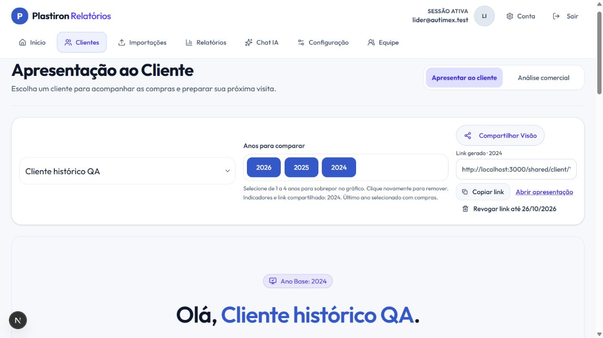

# Compartilhamento do cliente — 19/10/2026

## Caso reproduzido

Cliente fictício com uma compra de R$ 500 em 2024 e nenhuma compra em 2025/2026. Ao selecionar os três anos, a versão anterior usava 2026 como referência e recusava a criação do link, pois o endpoint exigia vendas nesse ano. A mensagem específica era substituída por um aviso genérico. Uma falha de permissão da área de transferência também caía no mesmo aviso, mesmo quando o link já estava salvo.

## Correção

- A referência da apresentação é o último ano **selecionado** que possui compras reais do cliente. Os demais anos continuam no gráfico, inclusive seus zeros. O ano usado nos indicadores e no link é informado junto aos filtros.
- Se nenhum ano selecionado possui compras, a tela explica a situação e desabilita o compartilhamento. Não são consultados anos fora da seleção para escolher a referência.
- O endpoint valida o corpo, resolve os códigos no escopo da sessão e comprova a existência de uma venda com limite de uma linha. Um período vazio retorna 422 com orientação para selecionar um ano com compras.
- O link gerado fica visível, com ações para copiar e abrir. Permissão de clipboard negada não invalida a criação nem força uma segunda requisição.
- Tokens continuam aleatórios, com somente seu hash armazenado, validade de sete dias e revogação. As consultas de criação continuam sujeitas ao RLS; não houve ampliação do escopo público.

## Evidências

- TypeScript e build de produção aprovados.
- 78 testes automatizados aprovados, incluindo ano vazio, anos não consecutivos, zero/devoluções, validação, escopo, armazenamento do hash, falhas de banco e cópia negada.
- 15 verificações de integração existentes aprovadas.
- Integração adicional com Auth/Postgres/RLS locais: rejeição de 2026 vazio; criação de link para 2024; apresentação pública por HTTP sem cookies retorna 200 com cliente/ano/total corretos; revogação impede nova resolução; representante e conta isolada não conseguem compartilhar as vendas exclusivas do líder.
- No navegador, apenas 2026 selecionado apresenta a orientação e botão desabilitado. Com 2024/2025/2026, a referência vira 2024, exibe R$ 500 e gera um link que abre a apresentação correta.

A correção não exige uma nova migration. Depende da publicação do código. Os testes utilizaram somente dados fictícios na stack local; não foi confirmada a resposta original do servidor de produção.

