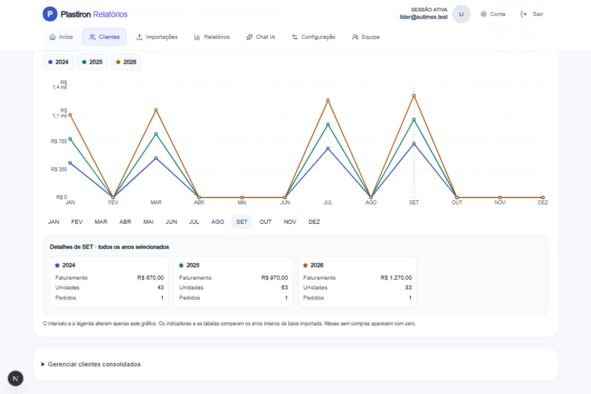

# Comparação da análise comercial — 05/10/2026

Implementação direta, sem skills, mantendo o tema claro.

## Comportamento

- A análise comercial aceita de um a quatro anos, inclusive anos não consecutivos. A seleção nunca fica vazia. A apresentação ao cliente mantém um único ano de referência.
- Faturamento, unidades, pedidos, produtos ativos, ticket médio, meses com compras e melhor mês aparecem por ano, sem somar períodos para simular uma comparação.
- Gráficos mensais de faturamento, unidades e pedidos permitem trocar linhas/barras, ocultar séries, escolher o intervalo exibido e consultar valores. Clique/toque no gráfico ou seleção de mês por teclado abre os detalhes dos três indicadores para todos os anos escolhidos.
- O intervalo e a legenda afetam apenas o gráfico. Indicadores e tabelas mostram os anos inteiros importados, com aviso sobre períodos incompletos.
- A aba Produtos busca no histórico completo paginado, sem o limite dos 100 produtos da RPC de ranking. Cada produto tem tabela anual e gráfico mensal comparativo. A lista mostra lotes de 25, com busca e ação para carregar mais.
- Oportunidades compara qualquer par dos anos selecionados. Com apenas um ano, a base é o ano anterior, indicado na tela. Itens novos ou sem recompra são preservados; base zero não produz uma porcentagem fictícia.
- Resumo usa agregados de um ano por vez. Linhas detalhadas são carregadas apenas em Produtos/Oportunidades. Cache inclui usuário, cliente e período, sob o prefixo invalidado pelas importações existentes.

## Validação

- TypeScript passou.
- 63 testes passaram, incluindo sete testes novos de comparação mensal, anos não consecutivos, zeros, produtos fora da seleção, deduplicação de pedidos por proprietário/data, mais de 100 produtos e oportunidades entre bases escolhidas.
- Build de produção passou, com 33 páginas geradas.
- `git diff --check` passou.
- Na aplicação local, com dados fictícios: comparação 2024/2025/2026, comparação 2024/2026, troca entre cliente individual e consolidado, proteção contra seleção vazia, métricas, linhas/barras, legenda, intervalo jul–set, clique na área do gráfico, busca de produto, detalhes por teclado e troca do ano base das oportunidades.
- Layout inspecionado em 1440 × 960, 390 × 844 e 320 × 720. As larguras da página foram menores ou iguais às larguras das telas; tabelas usam rolagem interna.

Não houve alterações de schema ou gravação de dados comerciais nos testes. A publicação em produção é uma etapa separada do envio do código ao repositório.

## Evidência

