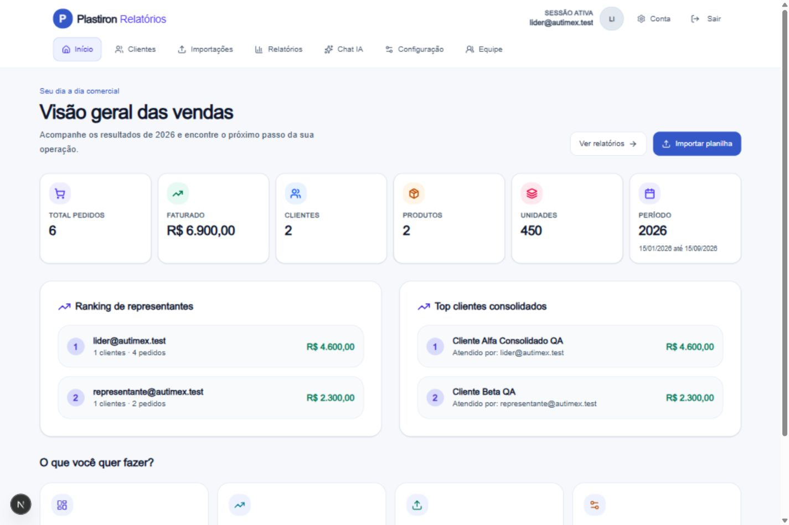

# Revisão de design e usabilidade — 05/10/2026

Revisão direta do código e da aplicação local, seguindo o pedido de uma interface exclusivamente clara. A identidade Plastiron e os fluxos comerciais existentes foram preservados. Nenhuma skill foi aplicada ao trabalho após a orientação do usuário.

## Resultado

O tema claro é explícito e independente da preferência do sistema operacional. Fundo `#f6f8fc`, superfícies brancas, texto principal `#17243c`, azul `#3558c8` para ações e bordas `#dce3ee`. A classe escura do documento, as variantes escuras dos componentes e os fundos escuros específicos foram removidos. Notificações, listas de busca, diálogos, gráficos, estados de erro e apresentações de clientes receberam o mesmo tratamento.

## Problemas encontrados e alterações

| Área | Problema | Alteração |
| --- | --- | --- |
| Tema | Modo escuro forçado no documento, notificações e componentes específicos | Tema claro fixo com `color-scheme: light`, cores centralizadas e notificações claras |
| Hierarquia visual | Efeitos de vidro, sombras e títulos muito grandes disputavam atenção com os dados | Superfícies sólidas, sombras discretas, títulos menores e espaçamento consistente |
| Legibilidade | Textos de 10–11 px e cores claras destinadas a fundos escuros | Textos auxiliares a partir de 12 px e contraste reforçado |
| Navegação | Menu apertado em telas intermediárias e seleção pouco evidente | Navegação em área própria, página atual destacada, ícones e disposição responsiva |
| Linguagem | “Upload”, “Modo Pitch Deck”, “Painel Técnico” e instruções sobre o Supabase | “Importações”, “Apresentar ao cliente”, “Análise comercial” e instruções em linguagem de uso |
| Página inicial | Conteúdo sem um próximo passo destacado | Ações “Importar planilha” e “Ver relatórios”; orientação inicial quando ainda não há dados |
| Indicadores | Cartões informativos pareciam clicáveis e valores grandes podiam ficar apertados | Remoção da seta e do movimento de hover; distribuição de 2, 3 ou 6 colunas e números legíveis |
| Filtros | Campos com largura mínima incompatível com celular; seleção mostrava `all` | Grade responsiva, campos rotulados e valores “Ano inteiro” e “Todas as receitas” |
| Filtros ativos | Limpeza escondida e cliente selecionado sem remoção direta | Ação de limpeza visível e chip removível do cliente |
| Abas | Personalizações esperavam `data-state`, enquanto Base UI usa `data-active` | Estado ativo consistente com o componente; abas com rolagem horizontal interna |
| Tabelas | Muitas colunas fixas podiam ocupar toda a tela e impedir a leitura dos meses | Fixação condicionada à largura disponível, região acessível por teclado e orientação de rolagem |
| Clientes | Gestão de consolidações dominava a entrada da tela de visitas | Busca e análise priorizadas; gestão reunida em área secundária recolhível |
| Clientes consolidados | Identificadores `group:<uuid>` apareciam como código e na busca | Rótulo “Consolidado” na apresentação dos códigos e sugestões |
| Formulário de grupos | Apagar o nome fazia o editor desaparecer | Estado de abertura independente do nome; salvar exige nome válido e dois clientes |
| Importação | Área de envio excessivamente espaçada no celular e rejeições de formato/tamanho sem orientação | Área compacta, ação visível de seleção, limites explícitos e mensagens de rejeição |
| Histórico | Falha de carregamento podia parecer ausência de importações | Estados separados de carregamento, erro com nova tentativa e primeira importação |
| Login | Erros em inglês, instruções técnicas e nenhuma opção de visualizar a senha | Erros orientativos em português, instruções claras e botão mostrar/ocultar senha |
| Recuperação | Identidade visual diferente da tela de login | Marca e superfície alinhadas ao restante do acesso |
| Apresentação | Fundo global escuro, hero ocupando quase uma tela e tooltip escuro no gráfico | Fundo claro local, introdução compacta, link para a análise e tooltip branco |
| Acessibilidade | Foco e associação de rótulos inconsistentes | Foco visível, link para pular navegação, labels associados, estados selecionados e tabelas identificadas |

## Validação

- `npm run typecheck`: passou.
- `npm test`: 56 testes passaram, sem falhas.
- `npm run build`: compilação de produção e TypeScript passaram; 33 páginas foram geradas. A primeira tentativa encontrou restrição de rede para Google Fonts; a verificação com acesso às fontes oficiais passou.
- `git diff --check`: sem erros de whitespace.
- Navegação local com a conta fictícia de líder: início, clientes, importações, relatórios, configuração, equipe, chat e conta.
- Verificação desktop em 1440 × 960 e móvel em 390 × 844; tela de clientes também em 320 × 720.
- Nas telas móveis examinadas, a largura da página coincidiu com a largura disponível. A tabela manteve sua rolagem interna, com zero colunas de dados fixadas no celular.
- Busca de cliente por nome e seleção por teclado verificadas. A apresentação do cliente consolidado exibiu seus dados no tema claro.
- Seleção de semestre, limpeza dos filtros e troca de relatório verificadas.
- O formulário de novo grupo permaneceu aberto após apagar o nome e manteve o salvamento desabilitado. O teste foi cancelado sem salvar.
- Mostrar/ocultar senha e mensagem de credenciais incorretas verificados; recuperação de senha inspecionada sem enviar e-mail.
- Confirmação do tema no navegador: `colorScheme = light`, fundo `rgb(246, 248, 252)` e ausência da classe `dark` no documento.

As telas de redefinição, erros e compartilhamento foram revisadas também no código. A apresentação usa o mesmo componente do link público. Validação de operações comerciais completas, envio de convites, troca real de senha e geração externa de IA não fizeram parte deste teste de interface.

## Evidência visual

O resultado está disponível no ambiente local. A publicação em produção permanece uma etapa separada.
