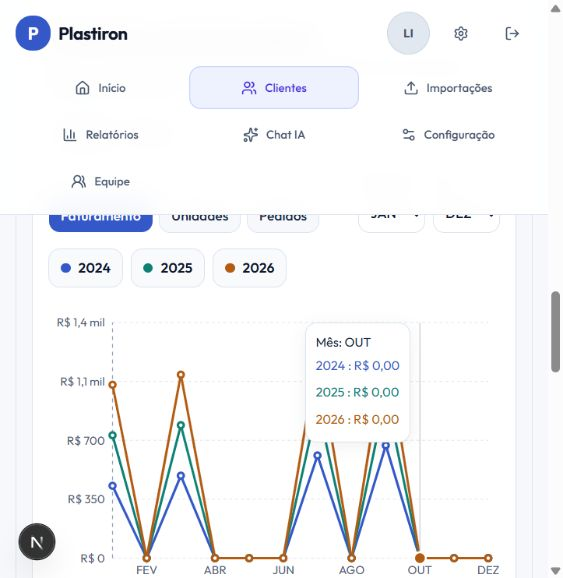

# Correções de Clientes e Relatórios — 19/10/2026

Correções implementadas e verificadas localmente com contas e vendas fictícias. A aplicação em produção e seus logs não foram acessados nesta validação.

## Comportamento corrigido

- A apresentação em Clientes permite selecionar de um a quatro anos e sobrepõe as séries mensais no próprio gráfico. Indicadores e compartilhamento mantêm como referência o ano mais recente selecionado, indicado junto aos filtros.
- Apresentação e análise comercial compartilham cache por usuário, cliente e ano. A apresentação consulta resumo, tendência e produtos; deixou de buscar histórico anual e últimos pedidos que não exibia. Requisições observadas no componente recebem cancelamento.
- O link público compara o ano autorizado com o anterior, usando somente as vendas que o compartilhamento já permitia consultar.
- O bootstrap dos relatórios carrega apenas anos e opções. Não gera mais um relatório completo sem filtros antes de consultar o cliente escolhido. Uma falha numa lista auxiliar preserva as outras opções e oferece nova tentativa.
- A falha do bootstrap não deixa indefinidamente os indicadores em carregamento nem impede consultar um período já selecionado.
- Trocar o tipo de relatório não reaproveita linhas de outro formato. Isso evita que Base de Itens processe linhas de Base de Compra durante a transição.
- Os seletores preservam o nome do cliente quando ele não está no lote atual de opções, em vez de mostrar `group:<uuid>`.
- A busca de produtos filtra no banco antes de limitar os resultados. Os tipos de receita vêm dos valores distintos, em vez de uma amostra das primeiras mil vendas.
- Os botões das telas de erro usam `retry`, conforme a API da versão do Next.js instalada.

## Verificações

- 69 testes automatizados aprovados, incluindo falha parcial no bootstrap, inexistência de consultas de relatório no bootstrap, envio de filtros ao banco e comparação de anos não consecutivos.
- TypeScript e build de produção aprovados.
- 15 verificações de integração existentes aprovadas com Auth/Postgres/RLS reais.
- Teste adicional em transação local com 1.205 produtos: busca por código e descrição encontra o último produto; receita fora das primeiras mil linhas é encontrada; representante e outra conta não leem as vendas exclusivas do líder; os novos RPCs negam execução anônima. A transação terminou em rollback.
- Navegador: apresentação do cliente consolidado com 2024/2025/2026; valores de janeiro conferidos em R$ 430 / R$ 730 / R$ 1.030; cinco abas de relatórios acessadas; totais de Base de Itens em 140 / 220 / 300 unidades; nome do grupo preservado após busca sem resultados e fechamento da lista.

## Medição local

Com 13.000 linhas sintéticas adicionais dentro de uma transação, `EXPLAIN ANALYZE` da Tabela Dinâmica de 2026 retornou os mesmos quatro grupos antes e depois. Tempo de execução: **202,257 ms → 145,356 ms** (aproximadamente 28% menor). A medição ilustra o efeito local; não representa a latência do servidor do cliente. O plano novo calcula o contexto da sessão uma vez por consulta com InitPlans. Dados sintéticos e alteração de schema do ensaio foram revertidos pela transação.

## Publicação

Aplicar as migrations anteriores, inclusive `0025_dashboard_period_summary_performance.sql`, e então `0026_report_filters_and_scope_performance.sql` **antes** de publicar o código. A 0026 cria dois RPCs de opções e otimiza a consulta/contexto de autorização sem alterar as condições de acesso. Ela foi aplicada somente na stack local nesta sessão.

Após publicar, repetir abertura de Relatórios com cliente consolidado, troca das cinco abas e seleção de múltiplos anos em Clientes. Confirmar o tempo de resposta com dados e logs do ambiente do cliente.

